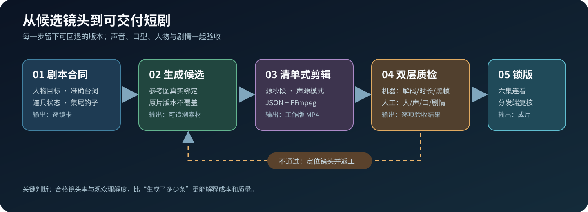
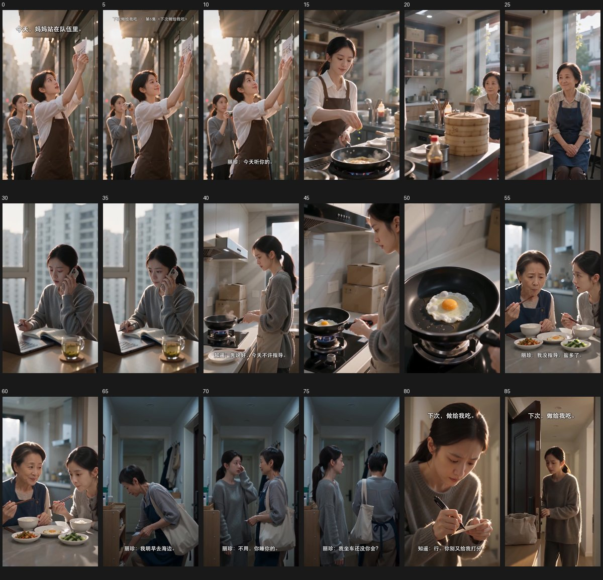

# 从一条广告到六集 AI 有声短剧

**一个真实制作项目沉淀的故事设计、镜头生产、声音验收和成本记录方法。**

[项目复盘](docs/project-retrospective.md) · [制作 SOP](docs/production-sop.md) · [技术实现与代码](docs/technical-implementation.md) · [成本核算](docs/cost-accounting.md)

## 项目是什么

《下次做给我吃》是一部六集、9:16 的 AI 有声竖屏短剧。起点是一条没有完整对白的母女早餐广告；我们重新设计了独立剧情：女儿知遥离职后接下早餐店拍摄工作，在名单中发现妈妈丽珍的店要转让。她以为妈妈缺钱，后来才知道妈妈打算把店交给徒弟阿禾，自己去看海。母女最终分别说出隐瞒的事，重新约定下一顿早餐。

六集成片合计约 **403 秒**，另有一条正片前预热片和一条独立宣传片。这里公开的是制作方法和复盘，不托管视频、原始素材或生成平台账号。作品使用 Musein 等外部生成工具和本地剪辑流程制作，**不是** [漫序 FrameFlow](https://github.com/Yiheng-guo/manxu-studio) 的产物；两者属于不同项目。

## 复盘后形成的从 0 到 1 工作流

这个流程是根据本次返工反推出来的下次做法；其中「先做双人对话小样」是改进项，不应说成本项目一开始就执行过。真正影响进度的是**合格镜头率**，不是生成了多少条视频。每条候选必须同时通过人物、声音、口型、动作与道具衔接检查，才进入时间线。完整操作步骤和模板见 [制作 SOP](docs/production-sop.md)。静态画面漫剧也能复用故事、分镜、声源与验收方法；口型和连续动作的实现需要按具体媒介调整。

## 这次确实遇到的问题

| 问题 | 表现 | 处理方式 |
|---|---|---|
| 故事不易理解 | 观众直接看第一集，不清楚女儿为何拍妈妈的店、妈妈为何转店 | 重写六集因果链；制作预热片帮助入戏，同时保留首集改进项 |
| 人物与道具跳变 | 换脸、双手机、围裙和餐具状态不一致 | 锁定主参考与道具账本，舍弃错误秒段，重生关键镜 |
| 声音机械或归属错误 | 妈妈的声音像念稿；第五集“你真去啊”对到妈妈嘴上 | 选通过试听的声线；正面对白优先用同镜同期声，逐句核对说话人与口型 |
| 假字与重复声 | “二十多年”字幕乱码，纸条伪字；第六集一句机器配音与原声叠加 | 错字移出关键画面、后期制作可控文字；停用不合格音轨并重剪 |
| 剪辑不顺 | 生视频的尾段发生动作或道具突变，硬接后有掉帧感 | 只取有效秒段，按动作接点和对白气口剪；音画一起裁切 |

上图是制作时的审片截图，不是成片海报；它展示了为什么必须在整集时间线上检查候选镜头。

## 怎么验收

1. **静音看**：人物是否一眼能认出；空间方向、站姿、道具数量、动作是否连续；关键文字是否可读。
2. **闭眼听**：谁在说话、是否回应上一句、语气是否自然；有没有漏字、重字、双层人声。
3. **带声逐镜看**：可见嘴和声音是否对应；电话是否先接听再传来远端声音；切点是否流畅。
4. **六集连看**：每集人物的选择是否推出下一集的问题；终章是否收束；不靠宣传物料才能看懂核心剧情。

技术检查包括解码、黑帧、时长与声轨；它不能代替人眼人耳判断演技、口型和故事是否成立。

## 成本与效率

Musein 逐笔账单去重并与期初、团队转入、期末余额勾稽后，制作期共消耗 **11,460 积分**：视频生成 **124 笔/11,378 分**，平台 AI 生成 **10 笔/82 分**。按 2026-10-02 官方优惠套餐折算，同等积分资源约 **¥526**；若现在购买足量套餐需 **¥528**。这是资源替代成本，个人账单未见现金充值，团队积分的资金来源仍需另核。Codex 主任务在交付前累计处理约 **4.39 亿 Token**，其中绝大部分是缓存输入，不能直接换算 API 账单。完整计算和口径见[成本核算](docs/cost-accounting.md)。

技术实现方面，项目用 [JSON 镜头清单](examples/episode-demo.json)固定源片、裁切秒段与声源模式，再由本项目使用的 [FFmpeg 渲染器](tools/render_v2.py)统一输出 720×1280/24fps，校验音视频流、时长、解码及内部切点黑帧。代码和声画同步的约束说明见[技术实现](docs/technical-implementation.md)。

本项目已完成六集本地成片及两条辅助视频。没有发布后的完播、追更或留存数据，不能把制作完成写成市场验证成功。下一步应让未参与制作的人盲看六集，记录理解断点，再测试首集修改和预热片的实际效果。

## 阅读顺序

- 想理解项目决策与真实返工：读 [项目复盘](docs/project-retrospective.md)。
- 准备自己做一部：按 [制作 SOP](docs/production-sop.md) 的关卡与检查清单执行。
- 想看镜头清单、渲染器和质检路由：读 [技术实现](docs/technical-implementation.md)。
- 要做预算或对外报告成本：读 [成本核算](docs/cost-accounting.md)。

封面与审片图来自本项目制作素材，包含 AI 生成画面；审片图仅用于说明制作与核查过程。本仓库没有收录赛事方提供的品牌素材，也没有使用第三方商业音乐。
